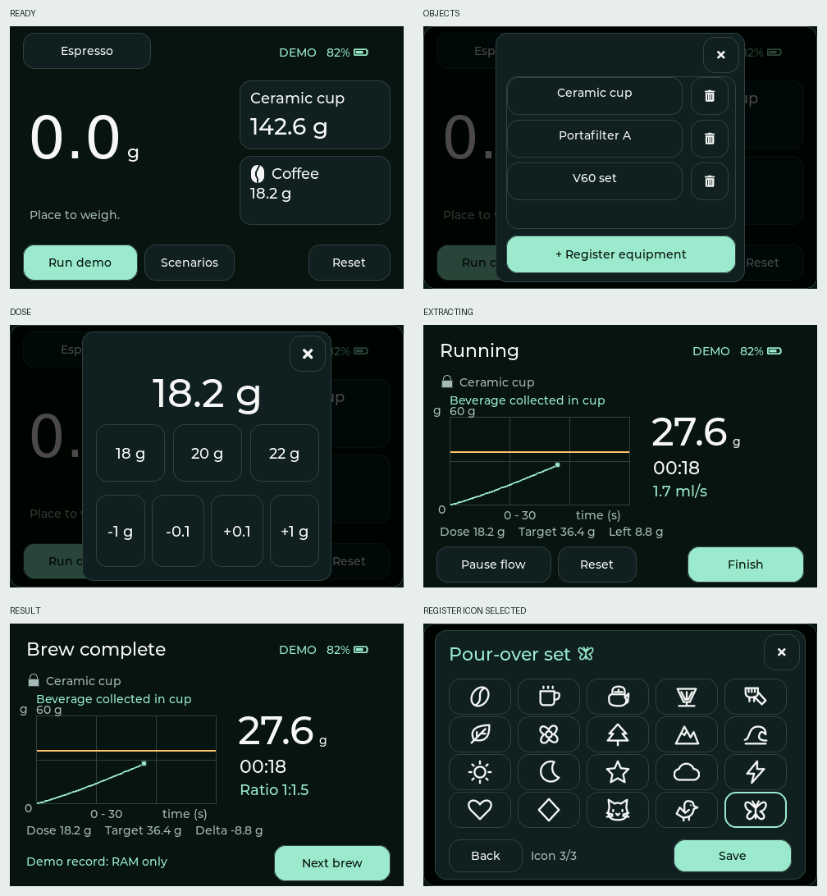

# Smart Scale

ESP-IDF + modern C++ coffee-scale UX prototype for the **Waveshare ESP32-S3-Touch-LCD-3.5** (ST7796 display / FT6336 touch). LVGL renders a 480 × 320 landscape interface on the native 320 × 480 panel.

**This is a dummy-data prototype.** Weight, flow, battery level, stable readings, and recognition scenarios are simulated. Equipment profiles and the last eight brew records live in RAM and disappear on reboot. No load-cell driver, calibration, network service, or machine control is connected.



## Quick start

Linux/macOS prerequisites: Git, Python 3.10+, Python venv support, Make, and a native C/C++ compiler. On Ubuntu, install `git python3 python3-venv python3-pip build-essential libffi-dev libssl-dev dfu-util libusb-1.0-0`. On macOS, install Xcode command-line tools, Git, Python, and dfu-util. Windows users can use WSL2 with USB forwarding; native Windows Make is not covered.

Clone the repository, then:

```sh
git clone https://github.com/omoon1/smart-scale.git
cd smart-scale
make install
make build
make probe
make flash /dev/ttyACM0
# macOS example: make flash /dev/cu.usbmodem1101
```

`make install` installs ESP-IDF **v5.5.2** at its pinned commit, its Python environment/toolchains, and pinned CMake/Ninja into `.tools/`. It can be rerun, refuses to overwrite a modified or different IDF checkout, and does not require activating a global ESP-IDF installation. Initial installation/build needs internet access. Keep the project path free of spaces, as required by the ESP-IDF build system.

| Command | Purpose |
| --- | --- |
| `make install` / `make setup` | Install the project-local toolchain |
| `make build` | Build ESP32-S3 firmware; target is already configured |
| `make probe` | List Linux/macOS serial port candidates without opening them |
| `make flash /dev/ttyACM0` | Flash the selected board, then open the monitor |
| `make monitor /dev/ttyACM0` | Serial monitor only; exit with Ctrl+] |
| `make flash PORT=...` / `make flash-monitor PORT=...` | Alternative syntax for flash, then monitor |
| `make menuconfig` | Configure ESP-IDF and LVGL |
| `make size` | Inspect firmware memory usage |
| `make clean` / `make fullclean` | Remove build output; retain `.tools/` |
| `make idf ARGS="--version"` | Run the local `idf.py` directly |
| `make idf ARGS="-p /dev/ttyACM0 flash monitor"` | Pass arbitrary IDF arguments |
| `make test` | Compile and run native state tests without ESP-IDF |
| `make preview` | Build actual LVGL UI and render PPM screenshots; exercise touch flows |
| `make simulator` | Run the same C++/LVGL UI in an SDL2 desktop window |

For the interactive desktop simulator, install SDL2 development files (`brew install sdl2` or `sudo apt install libsdl2-dev`). `make preview` requires CMake/Ninja, provided by `make install` or your package manager; it does not require SDL or a display server. Images are in `build-host/screens/`. `python scripts/screens.py` converts them to PNGs when Pillow is installed.

## Try the screens

1. Boot into the known-cup fixture: 142.6 g cup, automatic tare, measured 18.2 g dose.
2. Touch the **entire object card** to choose equipment or register a new profile. Touch the dose card for the dose editor: 18/20/22 g presets, plus ±1 g and ±0.1 g buttons across 0.1–60.0 g. Hold an adjustment button to repeat after 400 ms, every 100 ms until release or slide-off. Dose changes save immediately; close returns to weighing.
3. Tap the mode at the top to switch directly between Espresso and Pour-over. Mode and dose are locked during extraction in this prototype.
4. Tap **Run demo** to inject simulated liquid. This is a development control; production brewing will be triggered by sensor events. The app switches to extraction when that event arrives, including unknown-object cases.
5. Use **Scenarios** for known cup, unknown baseline, the portafilter → beans → removal → cup sequence, or V60 bloom/pours. The sequence starts after Run demo. A pour-over pause does not end the brew.
6. **Finish** opens results. Target arrival only alerts; simulated flow continues until Finish. **Next brew** starts an empty session after simulated load removal.
7. On-screen **Reset**, the board's **BOOT/GPIO0** button, or desktop **R** clears session values and marks an active RAM record aborted. Registered profiles remain until reboot. The board's hardware RESET/EN switch reboots the MCU and cannot execute this application action.

Registration has three steps: type (Container, Portafilter, or Pour-over set), simulated stable empty weight, and a 20-icon picker with distinct coffee, nature, sky, and personal symbols. Names are generated as the equipment type plus the selected icon; no keyboard is shown. Tap the stability badge to test the unstable state; Continue is disabled until stable. The list holds eight profiles, including fixtures. Tap a row’s trash button and confirm Remove to delete a profile. Current matching selections are cleared without taring; saved brew records are retained. Removal is disabled during brewing and results. Optional recipe defaults and editable measurement configurations are deferred.

## Implementation

The `.cxx`/`.hxx` organization, nested device namespaces, `device()` accessor, typed configuration, `std::optional`, and small C-linkage `app_main` follow the requested [serial_mb_slave pattern](https://github.com/farm360-ai/esp32_plc/tree/main/serial_mb_slave). Hardware initialization is explicit; no temporary lambda references or throwing log helpers are copied.

| Path | Responsibility |
| --- | --- |
| `main/session.hxx`, `session.cxx` | Platform-independent state, recognition helper, bounded RAM records, dummy source |
| `main/ui.hxx`, `ui.cxx` | LVGL screen rendering, modal drafts, event routing |
| `main/device.hxx`, `device.cxx` | Board I2C/SPI, display, touch, backlight, debounced BOOT button |
| `main/config.hxx` | Board pins, dimensions, capacities, explicit prototype assumptions |
| `host/` | Native framebuffer renderer and optional SDL2 adapter; same UI and model |
| `components/` | Minimal vendor ST7796 and FT6336 drivers with upstream licensing |
| `tests/` | State invariants and UX acceptance cases |
| `docs/` | Architecture, requirement coverage, hardware bring-up, validation |

See [architecture and scope](docs/architecture.md), [hardware setup](docs/hardware.md), and [validation](docs/validation.md).
