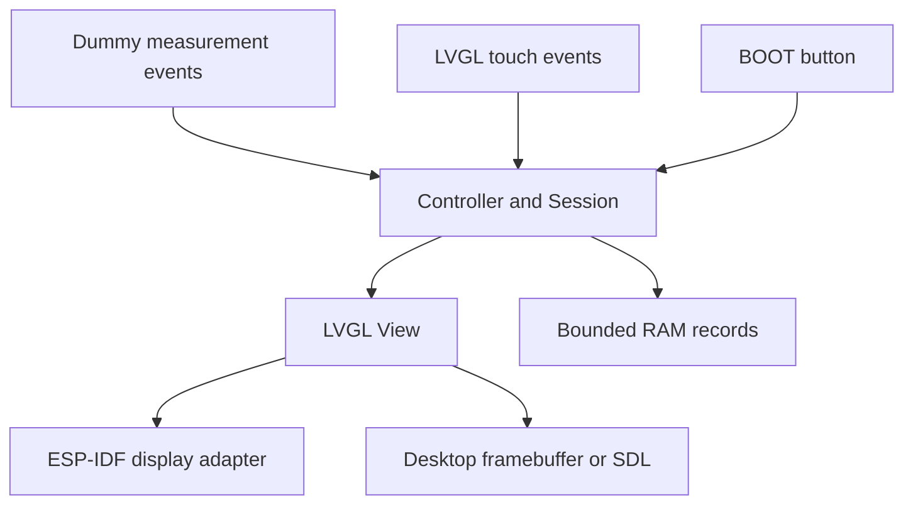
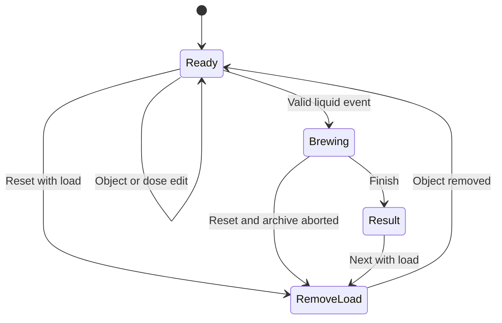

# Architecture and UX coverage

## Executive summary

This first milestone makes the supplied Smart Scale UX requirements reviewable on the target display and on a desktop. It implements the screen flows with deterministic dummy measurements. It does not claim production recognition, measurement accuracy, persistent storage, or physical start-detection performance.

## Boundaries and state

`Controller` owns application state; `View` reads it and dispatches commands. The domain only depends on the C++ standard library. Display transport lives in `device::display::Device`. `app_main` wires them together and updates the dummy source every approximately 100 ms using actual monotonic elapsed time.

All controller access, LVGL events, and redraws are serialized with the LVGL port lock on the device. The host is single-threaded. LVGL callbacks queue full redraws with `lv_async_call`, so an event never deletes its own live callback context. Frequent measurement updates modify existing labels/chart series rather than rebuilding the screen.

Reset without load goes directly to Ready. Opening a modal never changes the session. Starting extraction cancels unconfirmed modal edits and shows the last committed values. Modal state and the equipment registration draft are owned by `View`.

## Data and precision

`Session` separates the weighing portafilter, extraction vessel, and most recently placed object. Dose is optional and records a measured/manual source. Removing an object retains established roles and dose. An uncertain baseline suppresses cumulative weight, normal flow, ratio, and the actual curve rather than inventing precision.

Equipment and record snapshots are copied values; editing a later profile cannot mutate a past snapshot. Up to eight profiles and eight records are kept. Record retention is a documented FIFO ring; there is no durable storage in this milestone. Curves hold at most 601 timestamped samples; when full they are decimated while retaining the origin and actual timestamps. The chart plots those timestamps, not sample indices. Numeric values, curve, and record all use one session.

The standalone `recognize()` helper checks empty weight within a provisional 0.5 g tolerance and portafilter+dose candidates within the required inclusive ±3 g range. It returns the measured difference, not the saved usual dose. Different matching equipment IDs remain ambiguous. The on-screen dummy fixtures provide explicit recognition results; no load-cell classification or historical ranking service is connected yet.

Recipe assumptions are 1:2 for espresso and 1:15 for a whole pour-over set. They are target suggestions only, never actual-dose defaults. Pour-over cup-only has no input-water target. Dose wheel range is provisionally 0.1–60.0 g, step 0.1 g. The wheel can start at 18.0 g when unknown, but this is an uncommitted editor value until Apply. Unknown state is `?`.

## Requirement coverage

| Requirements | Prototype behavior / boundary |
| --- | --- |
| UX-01–04, OBJ-01–03 | Ready screen, full-card touch targets, separate net/tare/dose, unknown marker, extraction lock; placement/tare are simulated |
| MODE-01, DOSE-01–03 | Mode dialog, vertical dose wheel, apply/cancel, measured/manual source, no ratio without valid dose |
| REC-03/04/05/06/07 | Tested pure recognition helper with inclusive ±3 g, actual difference, separate empty tolerance, ambiguity, immutable empty reference |
| REC-01/02 | History-driven ranking and learning deferred; fixture usual-dose values only |
| SEQ-01–05, STATE-01–04 | Sequenced dummy events, split additions/removal, separate roles, session lifetime, value snapshots; long-term storage deferred |
| BREW-01 | Transitions on first dummy liquid event; physical detection ≤2 s remains a hardware acceptance test |
| BREW-02–06, END-01 | Weight/time/flow, timestamped graph and current point, target line, excess indication, pauses, manual finish, result delta and RAM save status |
| RESET-01–03 | BOOT and UI Reset, aborted RAM record, clears session, remove-load gate; MCU reset is a reboot |
| EQ-01–05 | Optional four-step registration, type-specific configuration, stable fixture weight, name, immutable record copies; editable configurations/defaults/deletion deferred |
| NFR-01 | Runtime is offline; persistent local records and deduplicated sync deferred |
| NFR-02/03 | 480×320 actual LVGL rendering, text plus color, shared time/measurement state; physical readability and power-loss recovery unverified |
| NFR-04 | No network stack is started and no cloud credentials/API are present |

## Corner Cases & Failure Modes

| Case | Behavior |
| --- | --- |
| Unknown object or baseline | Extraction still opens; unknown dose/weight/ratio remain `?`; uncertainty text visible |
| Two candidates have the same total | Recognition returns no identity; history cannot silently break the tie |
| Beans added then partly removed | Actual dose updates during preparation; no brew triggered by a stable pause |
| Cup removed during extraction | Identity and last valid weight retained; uncertainty latched; no automatic re-tare |
| Flow pauses / bloom | Timer continues; no automatic finish |
| Target exceeded | Actual excess displayed; no machine stop implied |
| Extraction starts in a popup | Draft discarded, committed values retained, modal closed |
| Reset under load | Session cleared; no zero capture until object removal |
| Nonfinite/out-of-range dose | Command rejected without changing established dose |
| Registration unstable/full/blank name | Continue or Save prevented; existing profiles retained |
| Long extraction | Bounded sample array decimates history; timestamps retained |
| More than eight demo records | Oldest RAM record overwritten |
| Power cycle / EN reset | RAM state lost and known demo fixture loaded; not presented as recovery |
| Display allocation or I2C initialization fails | Checked ESP-IDF error path stops initialization rather than using null handles |

## Next integration boundaries

Introduce a load-cell source that emits timestamped placement, stability, removal, dose, and liquid events. Keep a pre-detection buffer and qualify start detection against measured minimum flow/vibration conditions. Replace RAM records with a versioned NVS/filesystem repository and atomic writes before adding offline synchronization. Clarify automatic combination learning, unknown-object tare, equipment configuration editing, dose edit policy, and language/localization before treating prototype assumptions as production requirements.

No API is exposed by this firmware. A future BLE/cloud adapter should dispatch validated commands into the same serialized controller boundary, with pairing/authorization and idempotent record synchronization defined separately.
