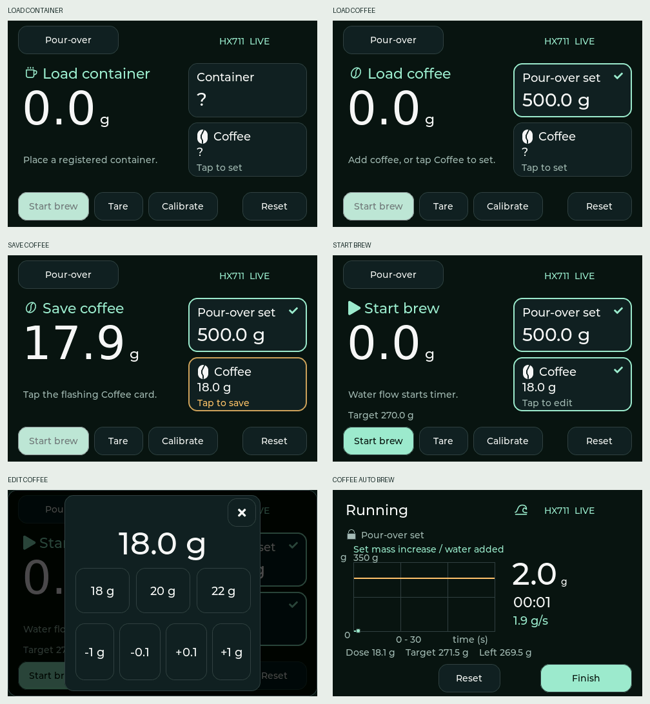

# Coffee registration and brewing readiness

The Coffee card saves a stable increase after a registered object has been recognized or selected. Recognition captures the actual placement reference; the profile's ±40 g recognition tolerance is not treated as coffee weight.

| State | Guidance | Coffee card tap |
| --- | --- | --- |
| No recognized object | Container icon / Load container | Existing manual editor |
| Recognized object, no saved dose, increase below 5 g | Bean icon / Load coffee | Existing manual editor |
| No saved dose, stable increase 5–60 g | Bean icon / Save coffee; amber pulsing border | Save measured increase once |
| Saved dose | Mint check / Tap to edit | Existing manual editor; changes apply immediately |
| Saved dose and registered brew vessel | Play icon / Start brew | Manual dose editing remains available |
| Sustained water flow | Wave icon / Running | Brewing controls; dose editing locked |

- A portafilter is a weighing tool: after saving its dose, show Load container until a brew vessel is placed. The coffee dose survives this transfer.
- A first dose saved with a brew vessel present establishes the water tare once. Later dose edits do not re-tare. Manual Start and automatic flow both require a registered brew vessel and a saved dose.
- Automatic start remains the existing sustained-flow detector, not a reaction to one sample. Saving primes the detector from the stable reading, so no extra stationary sample or Start press is required before pouring. Dialogs suspend automatic start.
- Sensor faults invalidate unsaved measurement references. Removal, reset, deletion, ambiguous identity, unstable readings, changed calibration, and values outside the existing 60 g maximum cannot save a stale candidate.
- Already-filled placements do not infer a dose retrospectively; use manual entry. Stored coffee is not overwritten by later sensor readings.
- Reset clears the session dose; equipment registration and persistence behavior are unchanged.
- Existing recipe ratios are retained: espresso 1:2, pour-over set 1:15. The concept image's 1:16 was illustrative.

## Validation

`make test` includes the coffee-registration suite at 10/~80 samples per second and both load-cell polarities. `make preview` additionally exercises the actual LVGL touch flow, including below-threshold manual entry, candidate pulse, tap-to-save, edit, no idle pulse after saving, and automatic start. It writes screens 29–34 under `build-host/screens`.

Hardware follow-up: check readability, pulse visibility, measured-dose accuracy, immediate pouring, and portafilter-to-cup transfer on the physical device.
