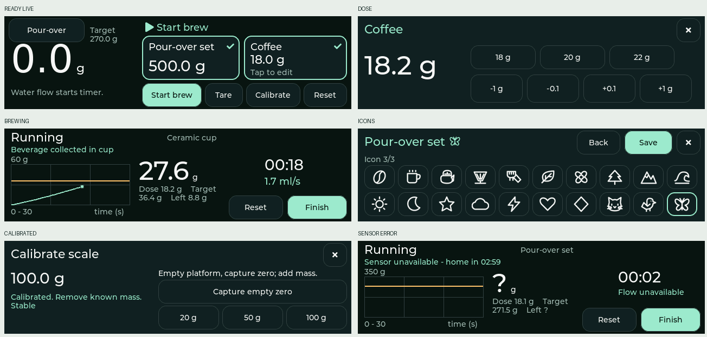

# 3.49-inch wide-panel UX

The Waveshare ESP32-S3-Touch-LCD-3.49 has a native **172 × 640** panel. This UI uses it horizontally as **640 × 172 logical pixels**. The view selects this layout from LVGL's registered resolution; the existing 480 × 320 UI remains available for host regression tests. Rev1.1 firmware uses the wide layout by default.



## Layout

- Home: large weight and baseline-aligned unit at left; workflow guidance above side-by-side container and coffee cards at right. Start, Tare, Calibrate and Reset remain directly accessible. Coffee still pulses for measured-dose registration.
- Brewing/results: chart at left, weight in the middle, elapsed time and flow/ratio at right. Full-width status line keeps sensor faults and recovery countdowns visible. Finish, Reset and Next remain accessible. The wide demo omits the optional flow-pause control to preserve space for the graph; real brewing has no pause action.
- Editors: full-screen sheets replace tall centered modals. Coffee has presets and press-and-hold adjustment controls. Calibration separates live readings from the zero/mass controls.
- Equipment: two columns of saved-equipment cards in a scrollable viewport, with a large persistent Register equipment button below; deletion still requires confirmation. Registration uses three selectable type cards instead of a dropdown, qualified live weight, and all 20 icons in a 10 × 2 grid without paging. Icon hit areas are 48 × 52 px.
- Registration navigation: Back above Continue/Save in the rightmost 18% (115 px); each button is 99 × 74 px with 8 px outer margins and an 8 px vertical gap. Back preserves selections while returning through steps. Save selects the new equipment and returns to the main screen. Redundant registration headings are removed.
- Wide action buttons are at least 44 px high; text and values retain native font sizes rather than scaling a 320 px layout down.

All layouts share the same controller, bindings, timers, validation and value-refresh path. No calibration, equipment, persistence or brew-state schema changes are introduced. Weight units and graph point positions use widget geometry instead of legacy screen coordinates.

## Reproduce and validate

```sh
make test
make preview                   # existing 480x320 demo, live and coffee suites
make preview-wide              # 640x172 demo and live interaction suites
python scripts/wide-screens.py  # export selected PNGs; requires Pillow
make simulator-wide            # interactive 1280x344 window; requires SDL2
```

`make preview-wide` produces 23 actual LVGL framebuffer captures in `build-host/screens/wide-*.ppm`. The interaction suites exercise dose presets/hold/release, all icon hit areas, registration stability gating, removal cancel/confirm, calibration with synthetic HX711 counts, measured coffee registration, manual editing, automatic brew start, sensor-fault countdown and return-home recovery. Existing state and legacy UI suites are also checked.

## Rev1.1 hardware port

The firmware now targets the AXS15231B board with separate expander/touch buses, QSPI full-frame transfers, matching landscape touch mapping, EXIO5 reset and EXIO1/GPIO42 backlight control. The old PMU read and ST7796/FT6336 drivers have been removed. See [hardware configuration and bring-up](hardware.md).

**HX711 wiring changes to DOUT IO44 / SCK IO43.** The old GPIO17/18 pair is used by touch on this board. Physical validation of display, touch, cold-start backlight and sensor operation is still required; host rendering cannot establish those properties.
